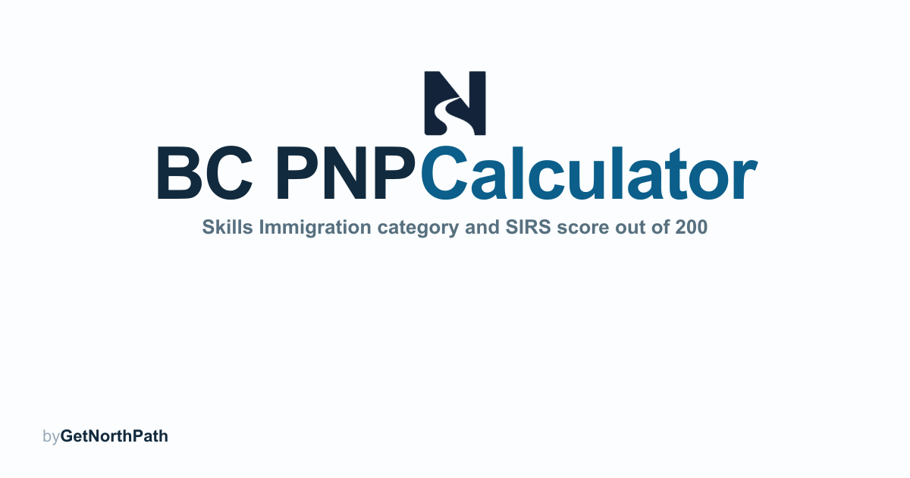

# GetNorthPath BC PNP



> **Find your Skills Immigration category, then estimate a SIRS score out of 200.**

**Free BC PNP category classifier and SIRS score calculator** from [GetNorthPath](https://www.getnorthpath.com). The grid in force since **4 December 2025** scores wage, work experience, education, language, and region. On **23 April 2026** the province restructured Skills Immigration around three pillars: Care, Build, and Innovate.

[](https://bcpnp.getnorthpath.com/)
[](https://www.getnorthpath.com)
[](docs/SCORING-MODEL.md)
[](docs/FEATURES.md#languages)

This repository is the **public information hub** for the product: what the calculator does, how categories and scoring work, and where the numbers come from. It is **not** the application source-code repository. The live site is [bcpnp.getnorthpath.com](https://bcpnp.getnorthpath.com/).

Documentation in this hub was checked against the live English site on **12 October 2026**. The invitation history published on the site runs through **20 August 2026**. If this hub and WelcomeBC or IRCC disagree, the official page wins.

---

## What this product does

The BC PNP calculator is a **free companion** for people preparing a Skills Immigration registration. You pick a 2026 priority category first, then enter the job offer, wage, region, experience, education, and language. The site estimates a Skills Immigration Registration System (SIRS) score out of **200** and compares that estimate with the latest published minimum for that category.

A higher score can improve ranking in a category’s pool. It does **not** guarantee an invitation, a provincial nomination, or permanent residence.

We do **not** replace WelcomeBC, the Government of British Columbia, or IRCC. Official pages always win.

### Live calculator


[Open the calculator](https://bcpnp.getnorthpath.com/) · [Methodology](https://bcpnp.getnorthpath.com/methodology) · [2026 draws](https://bcpnp.getnorthpath.com/draws)

---

## Key features

| Feature | Description |
| --- | --- |
| **Category first** | Care, Build, Innovate, the Innovate wage route, a rural and remote health initiative, or “not currently on a priority list” |
| **200-point estimate** | Wage (max 55), work experience (40), education (40), language (40), region (25). Age is not scored |
| **Verified vs estimate** | Published round minimums are treated as verified. Point bands inside the grid are labeled **EST.** where WelcomeBC has not published the formula |
| **2026 draw waypoints** | Milestone rounds and category ranges through 20 August 2026, including the 602-invitation round that day |
| **3 tools** | IELTS/CELPIP to CLB, a priority-occupation finder (demo subset), wage vs BC median |
| **Guides, pillars, occupations, regions** | Program overview, three pillars, five occupation examples, four region pages |
| **2 languages** | English unprefixed; French at `/fr/…` |
| **Free to use** | No account is required to see an estimate |

---

## How a visit works

```
1. Pick a 2026 category          →  Care, Build, Innovate, wage route, or not listed
2. Enter the job offer           →  Eligible employer and an indeterminate full-time offer
3. Enter wage, region, experience, education, language
                                 →  Estimate out of 200, with EST. labels
4. Compare with that category    →  Latest published minimum, or the wage-route bar
5. Optional next step            →  Guide, tool, draw table, or a consultation request
```

Detail: [docs/WORKFLOW.md](docs/WORKFLOW.md)

---

## Four different questions

| Question | What answers it |
| --- | --- |
| **Category** | Which pillar and 2026 priority list your occupation sits on. The calculator asks this before the score. |
| **Score estimate** | This calculator, from the published 200-point outline plus stated approximations. Independent. Not an official SIRS score. |
| **Invitation threshold** | Each round’s published minimum, after the round. 2026 category minimums on the site span 50 to 138. |
| **Official decision** | WelcomeBC invites and nominates. IRCC decides permanent residence afterward. |

---

## Who it’s for

- **Applicants** estimating a Skills Immigration score before registering in SIRS
- **People comparing pillars** (Care, Build, Innovate score route, Innovate wage route)
- **People outside Metro Vancouver** checking the region factor against the 35% outside-Metro nomination target
- **Readers who want the grid, the category ranges, and the 2026 waypoints in one place**, with sources

> *Not affiliated with the Government of British Columbia, WelcomeBC, or IRCC. The calculator is an independent estimate, not eligibility, and not legal advice.*

---

## Documentation in this repo

| Doc | What it covers |
| --- | --- |
| [ABOUT.md](ABOUT.md) | What the calculator is, and why this repository exists |
| [docs/PRODUCT.md](docs/PRODUCT.md) | Purpose, users, journey, limits |
| [docs/FEATURES.md](docs/FEATURES.md) | Verified feature and URL inventory |
| [docs/PAGES.md](docs/PAGES.md) | Page and route inventory |
| [docs/WORKFLOW.md](docs/WORKFLOW.md) | Category → offer → score → draw comparison → next step |
| [docs/SCORING-MODEL.md](docs/SCORING-MODEL.md) | 200-point structure and verified vs estimate factors |
| [docs/PILLARS.md](docs/PILLARS.md) | Care, Build, and Innovate |
| [docs/TOOLS.md](docs/TOOLS.md) | CLB converter, occupation finder, wage checker |
| [docs/OCCUPATIONS.md](docs/OCCUPATIONS.md) | Occupation pages published on the site |
| [docs/REGIONS.md](docs/REGIONS.md) | Metro Vancouver vs outside Metro |
| [docs/DRAWS.md](docs/DRAWS.md) | 2026 invitation history as published on the site |
| [docs/SOURCES.md](docs/SOURCES.md) | WelcomeBC, ESDC, and NOC sources |
| [docs/PRIVACY.md](docs/PRIVACY.md) | Verified privacy and contact behavior |

Index: [docs/README.md](docs/README.md)

---

## Links

### BC PNP calculator (this product)

- **Live site:** [bcpnp.getnorthpath.com](https://bcpnp.getnorthpath.com/)
- **Methodology:** [methodology](https://bcpnp.getnorthpath.com/methodology)
- **Draws:** [draws](https://bcpnp.getnorthpath.com/draws)
- **FAQ:** [faq](https://bcpnp.getnorthpath.com/faq)
- **Guides:** [guide](https://bcpnp.getnorthpath.com/guide)
- **Tools:** [tools](https://bcpnp.getnorthpath.com/tools)
- **Machine index:** [llms.txt](https://bcpnp.getnorthpath.com/llms.txt)

### Official sources (always win)

- **Skills Immigration:** [WelcomeBC](https://www.welcomebc.ca/immigrate-to-b-c/skills-immigration)
- **Invitations to apply:** [WelcomeBC 2026 rounds](https://www.welcomebc.ca/immigrate-to-b-c/skills-immigration/invitations-to-apply)
- **Wage data:** [ESDC open data on open.canada.ca](https://open.canada.ca/)
- **Occupations:** [NOC 2021, Statistics Canada](https://www.statcan.gc.ca/en/subjects/standard/noc/2021/index)

Full list: [docs/SOURCES.md](docs/SOURCES.md)

### GetNorthPath (parent)

- **Website:** [getnorthpath.com](https://www.getnorthpath.com)
- **Walkthrough:** [contact](https://www.getnorthpath.com/contact?intent=walkthrough&tool=bc-pnp-calculator#book)
- **Free DIY tools:** [getnorthpath.com/tools](https://www.getnorthpath.com/tools)
- **IRCC Ready Docs:** [docs.getnorthpath.com](https://docs.getnorthpath.com)
- **OINP Calculator:** [oinp.getnorthpath.com](https://oinp.getnorthpath.com)
- **AORTrack:** [track.getnorthpath.com](https://track.getnorthpath.com)
- **Privacy / terms:** [privacy](https://www.getnorthpath.com/privacy) · [terms](https://www.getnorthpath.com/terms)
- **GitHub org:** [github.com/Get-North-Path](https://github.com/Get-North-Path)

---

## License

Documentation in this repository is available under the **MIT License**. See [LICENSE](LICENSE).

© 2026 GetNorthPath. The BC PNP calculator is free to use. Not affiliated with the Government of British Columbia, WelcomeBC, or IRCC. The calculator is an **estimate**, not official government software, eligibility, or legal advice.
