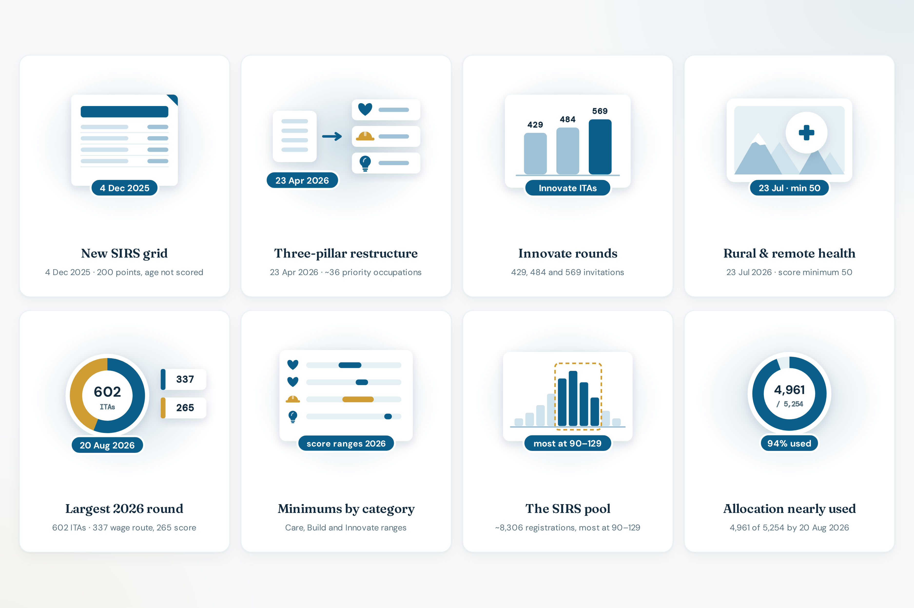

# 2026 draws

**Live:** [bcpnp.getnorthpath.com/draws](https://bcpnp.getnorthpath.com/draws)

Page title: “Every 2026 BC PNP Skills Immigration round.”

Checked on **12 October 2026**. The page’s own scope is milestone rounds and structural changes **through 20 August 2026**, taken from WelcomeBC’s invitations page. It says it is not an exhaustive log of every weekly or biweekly round. `dateModified` in the page schema is **2026-08-24**.

Direct answer on the page: the SIRS grid took effect **4 December 2025**; pillars landed on **23 April 2026**; through 20 August 2026, roughly **4,961** invitations had gone out toward a **5,254** nomination allocation, at minimums from **50 to 138**.

### Draws preview

| Draws |
| :---: |
|  |

---

## Waypoints published on the page

| Date | Event | Detail on the site |
| --- | --- | --- |
| 2025-12-04 | New SIRS grid in force | 200 points: wage 55, experience 40, education 40, language 40, region 25. Age not scored |
| 2026-01-07 | Interim priority guidance closes | Transitional invitation guidance from the grid change wound down |
| 2026-02-04 | Innovate round | 429 invitations, under the previous tech / high-impact structure |
| 2026-04-22 | Innovate round | 484 invitations, the last major round before the restructure |
| 2026-04-23 | Care / Build / Innovate restructure | NOC-list streams replaced by three pillars; about 36 priority occupations; 35% of nominations targeted outside Metro Vancouver |
| 2026-05-05 / 05-06 | First post-restructure rounds | Initial invitations under the new categories |
| 2026-07-16 | Innovate round | 569 invitations |
| 2026-07-23 | Rural and remote health initiative | Score minimum 50. Narrowly targeted, not a general drop in the bar |
| 2026-08-06 | Five priority-category rounds | Roughly 505 invitations combined across Care, Build, and Innovate |
| 2026-08-20 | Largest 2026 round | 602 invitations: 337 via the Innovate wage route (≥ $55/hr) with no score minimum, and 265 via the score route (minimum 132) |

The homepage stat “602 ITAs, largest 2026 round” refers to 20 August 2026.

---

## Category ranges published on the page

| Category | Pillar | 2026 score range |
| --- | --- | --- |
| Health | Care | 84–108 |
| Childcare (ECE) | Care | 102–115 |
| Education | Care | 68 |
| Veterinary | Care | 72 |
| Construction trades | Build | 88–121 |
| Score route (all sectors, including tech) | Innovate | 132–138 |
| Wage route (no score minimum) | Innovate | $55–70/hr |
| Rural and remote health initiative | Care | 50 (one-off, narrowly targeted) |

The calculator’s “most recent minimum” is the low end of each score range above, except the wage route, which shows **$55/hr**.

---

## Pool context on the page

As of **4 August 2026**, roughly **8,306** registrations were in the SIRS pool, most between **90 and 129**. The page says most of the year’s 5,254 nomination allocation had already been used by 20 August 2026.

That pool description is what the calculator’s “illustrative pool position” lines refer to. The calculator says it is not the official distribution.
