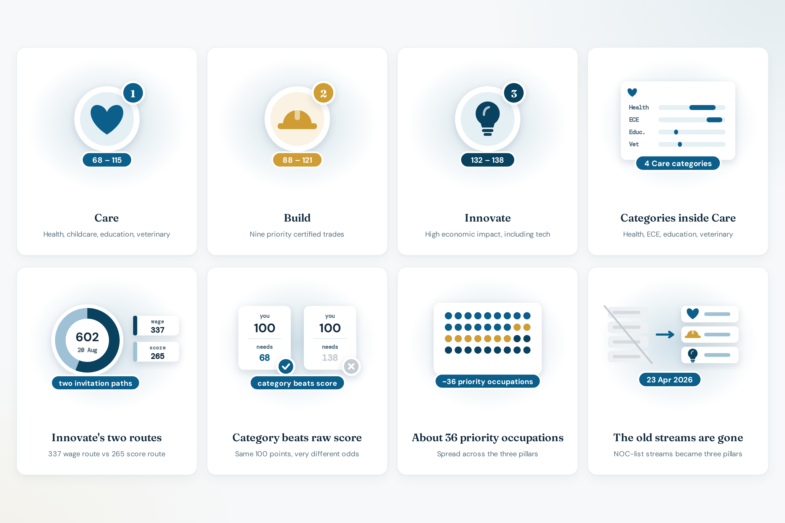

# Pillars

Since **23 April 2026**, the site describes Skills Immigration as three pillars. Category is chosen on the calculator before the score. Hub: [bcpnp.getnorthpath.com/pillars](https://bcpnp.getnorthpath.com/pillars). Explainer: [guide/care-build-innovate](https://bcpnp.getnorthpath.com/guide/care-build-innovate).

### Pillars preview

| Pillars |
| :---: |
|  |

The homepage cards:

| Pillar | Card line |
| --- | --- |
| Care | Health, childcare, education, veterinary · 50–115 pts |
| Build | Nine priority certified trades · 88–121 pts |
| Innovate | Score route 132–138 · wage route $55–70/hr |

The 50 at the low end of Care is the rural and remote health round, which the site treats as narrowly targeted, not a general Care floor. Education’s published figure on the category table is 68.

---

## Care

**Live:** [bcpnp.getnorthpath.com/pillars/care](https://bcpnp.getnorthpath.com/pillars/care)

Health, childcare (ECE), education, and veterinary. The page’s summary: 2026 score minimums ranged from **68** (Education) to **115** (Childcare), plus a one-off **50**-point rural and remote health round.

Calculator categories inside Care:

| Category | Range on the site | Most recent minimum used in the panel |
| --- | --- | --- |
| Health | 84–108 | 84 |
| Childcare (ECE), NOC 42202 | 102–115 | 102 |
| Education | 68 | 68 |
| Veterinary | 72 | 72 |
| Rural and remote health initiative | 50 | 50 |

Occupation pages linked from Care: registered nurses, early childhood educators, veterinary.

The rural round is dated **23 July 2026** on the FAQ (the draw table lists the event as **2026-07-23**). The FAQ says the low score reflects a thin, specific pool, not a lower bar for every Care candidate.

---

## Build

**Live:** [bcpnp.getnorthpath.com/pillars/build](https://bcpnp.getnorthpath.com/pillars/build)

Nine priority certified construction trades. The 2026 score minimum ranged from **88 to 121**. The calculator uses **88** as the most recent minimum.

Occupation page: [construction trades](https://bcpnp.getnorthpath.com/occupations/construction-trades). The site also points Build readers at the outside-Metro region pages, because the regional nomination target is part of the trades story it tells.

---

## Innovate

**Live:** [bcpnp.getnorthpath.com/pillars/innovate](https://bcpnp.getnorthpath.com/pillars/innovate)

High economic impact occupations across sectors, including tech. The site says there is no separate BC tech stream after the April 2026 restructure.

Two invitation paths:

| Path | What the site publishes | How the calculator treats it |
| --- | --- | --- |
| Score route | 132–138 in 2026 | Compares the estimate with minimum **132** |
| Wage route | $55–70/hr, no score minimum | Does not use a SIRS minimum. Latest bar shown: **$55/hr**. Described as TEER 0–3 |

On **20 August 2026**, the draw page says **602** invitations: **337** via the wage route (≥ $55/hr, about $110k/year) and **265** via the score route (minimum 132).

Occupation example: [software developers](https://bcpnp.getnorthpath.com/occupations/software-developers). Related tool: [wage vs median](https://bcpnp.getnorthpath.com/tools/wage-vs-median).

---

## Not on a priority list

The calculator includes “Not currently on a priority list.” The note says to check the Health Authority stream or Entrepreneur Immigration, and that this calculator excludes those programs. No draw comparison is shown.
