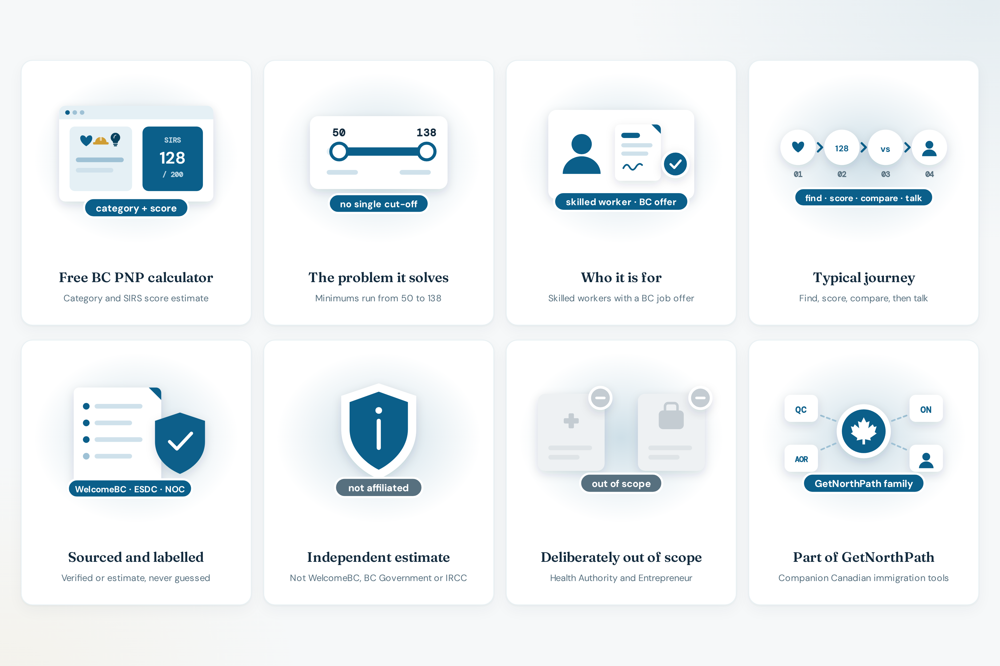

# What the BC PNP calculator does

**GetNorthPath BC PNP** ([bcpnp.getnorthpath.com](https://bcpnp.getnorthpath.com/)) is a free web app that classifies a Skills Immigration profile into a 2026 category and estimates a SIRS score out of 200.

Live: [bcpnp.getnorthpath.com](https://bcpnp.getnorthpath.com/)

It is a **focused product**: a calculator, three companion tools, guides, pillar pages, five occupation examples, four region pages, an FAQ, a draw history, and a methodology page. It is **not** a full immigration case-management system, and it does not file a SIRS registration. Broader Canadian immigration tools live on [getnorthpath.com](https://www.getnorthpath.com). See [ABOUT.md](../ABOUT.md).

### Product preview

| Product |
| :---: |
| [](https://bcpnp.getnorthpath.com/) |

---

## Problem it addresses

Skills Immigration invitations in 2026 are not a single cut-off:

- **Category** changes the bar. Published minimums on the site span **50 to 138**
- The **23 April 2026** restructure replaced older NOC-list streams with **Care, Build, and Innovate**
- The **Innovate wage route** invites some people with no SIRS minimum at all, at a published hourly wage bar
- **Region** is both a point factor (up to 25, modeled as outside Metro Vancouver) and a policy target (at least 35% of nominations outside Metro Vancouver)
- Several factors on the 200-point outline do not have a public formula yet, so a calculator that hides that uncertainty would overstate precision

The product asks for the category before the score, and it labels approximated bands **EST.**

---

## Product surfaces

```
bcpnp.getnorthpath.com
├── Home                 calculator, pillars, FAQ teaser, consultation
├── Guides               program, pillars, scoring factors, documents
├── Tools                CLB, occupation finder, wage vs median
├── Pillars              Care, Build, Innovate
├── Occupations          five worked examples
├── Regions              Metro, outside Metro, Interior, Vancouver Island
├── FAQ                  11 questions
├── Draws                2026 waypoints through 20 August 2026
├── Methodology          verified vs estimate
└── French               same paths under /fr
```

Details: [FEATURES.md](FEATURES.md) · [WORKFLOW.md](WORKFLOW.md) · [SCORING-MODEL.md](SCORING-MODEL.md)

The XML sitemap published on **12 October 2026** lists **56** URLs: 28 English and 28 French. `robots.txt` allows `/` and disallows `/api/`.

---

## Who it is for

- People with a **BC job offer** who want a category and a SIRS estimate before they register
- People in **health, childcare, education, veterinary, certified trades, or high-economic-impact roles** checking which pillar the site assigns
- People comparing the **Innovate score route** (132–138 in the site’s 2026 table) with the **wage route** ($55–70/hr, no score minimum)
- Readers who want the **draw waypoints** and the **methodology gaps** in one place

---

## User journey (typical)

1. Land on the homepage. The banner says Skills Immigration was rebuilt around three pillars on 23 April 2026, and links to methodology.
2. Choose a category from the 2026 priority list (default on the form: Care: Health).
3. Enter employer type, whether the offer is indeterminate and full-time, hourly wage, an illustrative median, region, months of experience, education, and four CLB levels.
4. Read the estimate out of 200, the offer-type gate, and the comparison with that category’s latest published minimum.
5. Open a guide, tool, occupation page, or the draw table.
6. Optionally submit the consultation form. The category and score string is attached as a read-only field.

Express Entry alignment is a checkbox on the form. The page says a nomination through an Express Entry-aligned stream adds **600 CRS points**. That checkbox does not add points to the 200-point SIRS total.

---

## What a result means

| The site shows | The site does not show |
| --- | --- |
| An independent estimate and a category label | An official SIRS score from WelcomeBC |
| Whether the offer type passes the calculator’s gate | A decision that the person is eligible to register |
| A comparison with a published round minimum | A prediction of the next round |
| Illustrative pool bands (90–129 as of 4 August 2026) | The official pool distribution |

Entrepreneur Immigration and the Health Authority stream are out of scope. The Health Authority path is described as a direct application with no SIRS registration. If that employer type is selected, the calculator says this score does not apply.

---

## Limits the product states

From [methodology](https://bcpnp.getnorthpath.com/methodology), these items are still open:

- The exact wage-to-points formula, and whether the comparison is to a BC-wide, regional, or occupational median
- The full work-experience and education tables from WelcomeBC or the SIRS user guide
- Point bands by regional district, rather than a flat Metro / non-Metro split
- A priority occupation list kept in sync with the current WelcomeBC NOC publication

The occupation finder is labeled a **demo subset**, not the full NOC 2021 catalogue. Median wages on the calculator are **placeholders** per category. The page tells the reader to look up the ESDC figure for their NOC and region.

---

## Languages

English is the default and has no locale prefix. French uses `/fr` plus the same path, for every URL in the sitemap. Example: [bcpnp.getnorthpath.com/fr/draws](https://bcpnp.getnorthpath.com/fr/draws).

---

## Cost

Seeing a score does not require an account or a payment. A consultation request and the header walkthrough are optional. The walkthrough opens the parent contact page with `intent=walkthrough` and `tool=bc-pnp-calculator`.
