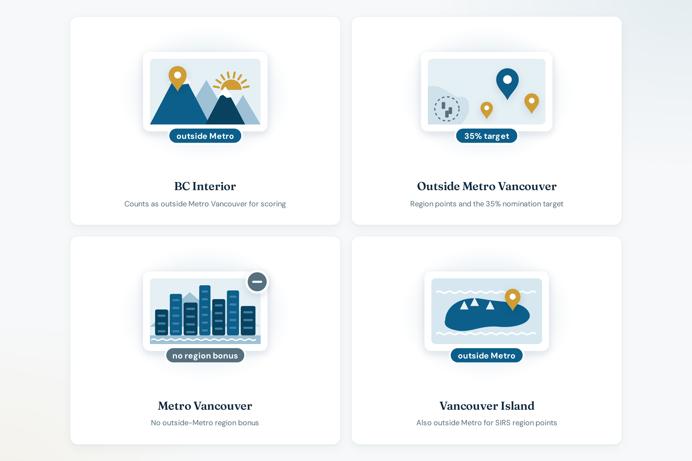

# Regions

Hub: [bcpnp.getnorthpath.com/regions](https://bcpnp.getnorthpath.com/regions)

Title: “Where you work changes your SIRS points.”

The calculator scores **regional district**, with two choices: Metro Vancouver, or everywhere else. The methodology page says exact bands by district were not available, so the model is flat. Some places outside Metro Vancouver may score differently in the real grid.

The site also describes a policy target: **at least 35%** of nominations outside Metro Vancouver. That target is context. It is not a sixth scoring factor.

### Regions preview

| Regions |
| :---: |
|  |

| Page | Inside or outside Metro on the site | Region points in the calculator |
| --- | --- | --- |
| [Metro Vancouver](https://bcpnp.getnorthpath.com/regions/metro-vancouver) | Inside | 0 |
| [Outside Metro Vancouver](https://bcpnp.getnorthpath.com/regions/outside-metro-vancouver) | Outside | 25 (estimate) |
| [Vancouver Island](https://bcpnp.getnorthpath.com/regions/vancouver-island) | Outside | 25 (estimate) |
| [BC Interior](https://bcpnp.getnorthpath.com/regions/bc-interior) | Outside | 25 (estimate) |

Maximum region points: **25**. See [SCORING-MODEL.md](SCORING-MODEL.md).

Related occupation links on the region pages include registered nurses, software developers, and construction trades, depending on the page.
