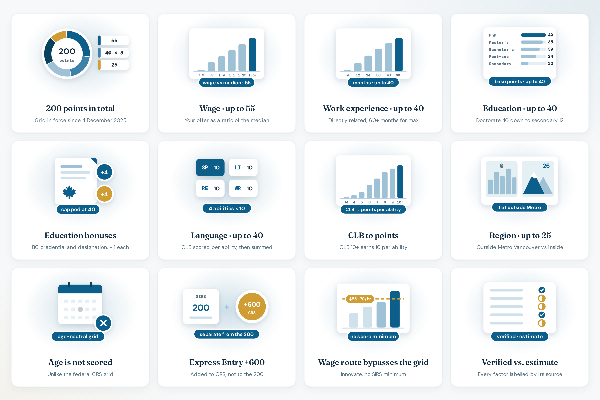

# Scoring model

How [bcpnp.getnorthpath.com](https://bcpnp.getnorthpath.com/) turns a form into a number. This is the calculator’s model. It is **not** a copy of an official WelcomeBC point table.

The methodology page splits factors into two labels:

- **Verified:** the figure comes from a primary WelcomeBC source
- **Partial / estimate:** the source gave a range or a policy description, and the calculator uses a stated approximation. The form marks those factors **EST.**

Grid in force since **4 December 2025**. Categories restructured **23 April 2026**. Total **200**. **Age is not scored.**

### Scoring preview

| Scoring |
| :---: |
|  |

---

## Verified outline

| Factor | Maximum on the site | Status |
| --- | --- | --- |
| Wage | 55 | Partial. Formula below is the calculator’s estimate |
| Work experience | 40 | Partial |
| Education | 40 | Partial |
| Language (CLB, per ability) | 40 | Partial |
| Region | 25 | Partial |
| **Total** | **200** | Verified as the published maximum |
| Age | 0 | Verified as not scored |
| Category round minimums | n/a | Verified as published round results. See [DRAWS.md](DRAWS.md) |

Express Entry alignment is collected and is **not** added to this total.

---

## Wage vs median (estimate, max 55)

`points` from `offered hourly wage / illustrative median`:

| Ratio at least | Points |
| --- | --- |
| 1.50 | 55 |
| 1.25 | 45 |
| 1.10 | 35 |
| 1.00 | 25 |
| 0.90 | 15 |
| below 0.90, or no median | 0 |

The methodology page says it is not confirmed whether the real comparison is to the BC median or a regional or occupational median. The homepage says it is also unconfirmed whether the factor is worth 55 or up to 100. This build uses 55.

Illustrative medians pre-filled on the form are placeholders, not ESDC extracts. Look up the wage for the NOC and economic region before relying on the wage points.

The Innovate **wage route** is separate: the result panel does not use a SIRS minimum. The most recent bar shown is **$55/hr** (published range **$55–70/hr**) for TEER 0–3 offers.

---

## Work experience (estimate, max 40)

Directly related, paid, same occupation, inside or outside Canada. Months:

| Months at least | Points |
| --- | --- |
| 60 | 40 |
| 48 | 34 |
| 36 | 27 |
| 24 | 19 |
| 12 | 10 |
| under 12 | 0 |

The methodology page says these month bands are modeled on typical provincial-nominee scales, not a confirmed WelcomeBC table.

---

## Education (estimate, max 40)

| Highest level | Points |
| --- | --- |
| Secondary | 12 |
| Post-secondary certificate or diploma | 24 |
| Bachelor’s degree | 30 |
| Master’s degree | 35 |
| Doctorate | 40 |
| No level selected | 0 |

Then, still capped at 40:

- BC or Canadian post-secondary credential: **+4**
- Professional designation relevant to the occupation: **+4**

The methodology page says the exact published breakdown by credential type was not available for this build.

---

## Language (estimate, max 40)

Each of speaking, listening, reading, and writing is scored, then added. Per ability:

| CLB at least | Points |
| --- | --- |
| 10 | 10 |
| 9 | 9 |
| 8 | 8 |
| 7 | 6 |
| 6 | 4 |
| 5 | 2 |
| 4 | 1 |
| below 4 | 0 |

Four abilities at CLB 10 or above sum to 40. The methodology page says these per-ability bands are not confirmed against a published table.

IELTS General Training and CELPIP General can be converted on the [CLB tool](https://bcpnp.getnorthpath.com/tools/clb-converter). The homepage also mentions PTE as a way people obtain a CLB. The converter page itself is documented as IELTS and CELPIP.

---

## Region (estimate, max 25)

| Location | Points |
| --- | --- |
| Metro Vancouver | 0 |
| Outside Metro Vancouver | 25 |

The methodology page says some regions outside Metro Vancouver may score differently in reality. Vancouver Island and the BC Interior are both treated as outside Metro on their pages. See [REGIONS.md](REGIONS.md).

The 35% outside-Metro nomination target is policy context on the site. It is not an extra point factor on top of the 25.

---

## Offer gates

These do not add points. They change the message next to the total:

| Input | Result |
| --- | --- |
| Health authority employer | Score does not apply. That stream has no SIRS registration |
| Full-time indeterminate offer is No | Gate fails. The total would not matter until the offer is fixed |
| Category is “not currently on a priority list” | Gate fails. No 2026 round line |
| Eligible employer and full-time Yes, and a listed category | Gate passes. Still not an invitation |

---

## Draw comparison and pool line

For a score-route category, the panel compares the total with that category’s **latest** published minimum and shows the **range**.

For the wage route, the panel states that the route does not use a minimum score and shows the latest published hourly bar.

Pool copy, for any listed category:

| Estimate | Label on the site |
| --- | --- |
| 130 or more | Toward the top of a pool that mostly sits at 90–129 |
| 90–129 | Typical middle of that pool |
| under 90 | Below where most of that pool sits |

The pool size cited is **8,306** registrations as of **4 August 2026**. The sentence says this is not the official distribution.

---

## What this model leaves out

- Entrepreneur Immigration’s separate points system
- Health Authority applications
- A full NOC search (the finder is a demo subset of the priority list)
- District-level region bands
- Any claim that the next round will repeat the latest minimum
