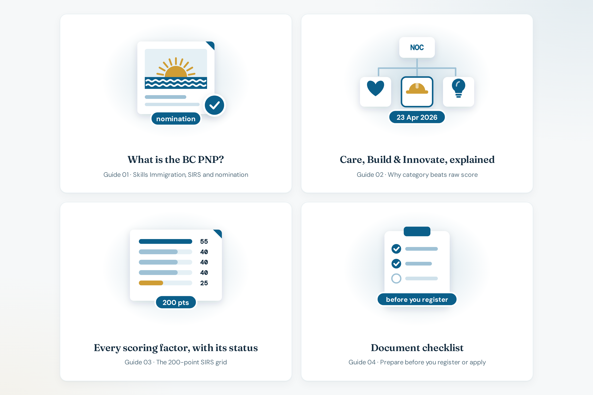

# Guides

**Live:** [https://bcpnp.getnorthpath.com/guide](https://bcpnp.getnorthpath.com/guide)

Hub title: **BC PNP guides, step by step.**

Plain-language explainers for Skills Immigration: how the program works, what Care / Build / Innovate mean, how every SIRS factor is scored, and which documents to prepare. The hub offers “Run the calculator” and then links onward to tools, pillars, and the FAQ.

### Guides preview

| Guides |
| :---: |
|  |

---

## Guides on the hub

| Guide | What the card says |
| --- | --- |
| [What is the BC PNP?](https://bcpnp.getnorthpath.com/guide/what-is-bc-pnp) | What Skills Immigration is, how SIRS registration works, and what a provincial nomination gets you |
| [Care, Build & Innovate, explained](https://bcpnp.getnorthpath.com/guide/care-build-innovate) | How the April 2026 restructure maps occupations into Care, Build, or Innovate, and why category beats raw score |
| [Every scoring factor, with its status](https://bcpnp.getnorthpath.com/guide/scoring-factors) | Wage, experience, education, language, and region on the 200-point grid |
| [Document checklist (general)](https://bcpnp.getnorthpath.com/guide/documents-checklist) | A practical document list to prepare before registering or applying |

Scoring detail that matches the calculator’s labels is in [SCORING-MODEL.md](../SCORING-MODEL.md). The checklist is a preparation guide. The site does not accept those documents as uploads.

---

## Related pages

- [Tools](https://bcpnp.getnorthpath.com/tools)
- [Pillars](https://bcpnp.getnorthpath.com/pillars)
- [FAQ](https://bcpnp.getnorthpath.com/faq)
