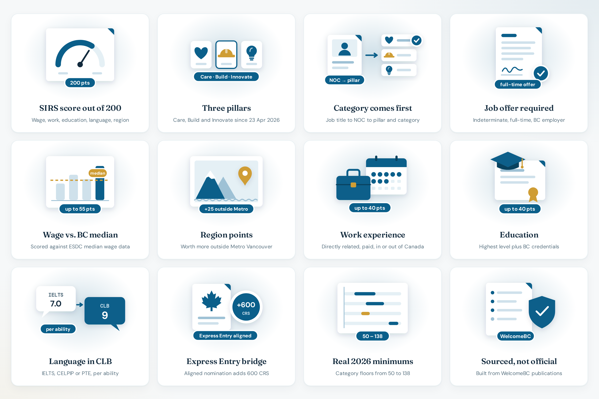

# Home

**Live:** [https://bcpnp.getnorthpath.com/](https://bcpnp.getnorthpath.com/)

The homepage is the **BC PNP Skills Immigration calculator**. Title: *BC PNP Category Classifier & SIRS Score Calculator 2026*. No account is required to see an estimate.

### Home preview

| Home |
| :---: |
|  |

---

## What you do here

1. Read the 23 April 2026 pillar banner and, if needed, open methodology
2. Scan the three pillar cards (Care, Build, Innovate)
3. Fill the form: category, offer, wage, region, experience, education, language, Express Entry checkbox
4. Read the SIRS estimate out of 200, the offer gate, and the category minimum
5. Use a next-step suggestion, the FAQ teaser, or the consultation form

Hero line verified on 12 October 2026: **Which category are you in, and what does it pay?** Stats: **200 points max**, **3 pillars**, **602 ITAs, largest 2026 round**.

---

## On-page sections

| Block | Purpose |
| --- | --- |
| Avis | Pillar restructure date and a link to what is verified |
| Hero | Harbour and flag image, headline, 200 / 3 / 602 |
| Direct answer | No single cut-off; 2026 minimums from 50 to 138 |
| Pillar cards | Care 50–115, Build 88–121, Innovate 132–138 and $55–70/hr |
| Calculator | Steps 00–07, documented in [WORKFLOW.md](../WORKFLOW.md) |
| Result panel | Estimate, EST. factors, gate, draw line, pool line, next steps |
| Beyond the number | Category vs total, region policy, wage-integrity warning |
| Quick answers | Four FAQ items and a link to the full FAQ |
| Consultation | [PRIVACY.md](../PRIVACY.md) |
| Footer | Nav groups, official WelcomeBC links, parent privacy and terms, Featured on |

---

## Related pages

- [Methodology](https://bcpnp.getnorthpath.com/methodology)
- [Draws](https://bcpnp.getnorthpath.com/draws)
- [FAQ](https://bcpnp.getnorthpath.com/faq)
- [Tools](https://bcpnp.getnorthpath.com/tools)

**Official sources (page chips):** WelcomeBC Skills Immigration · WelcomeBC invitations to apply (2026) · ESDC wage open data · NOC 2021, Statistics Canada
