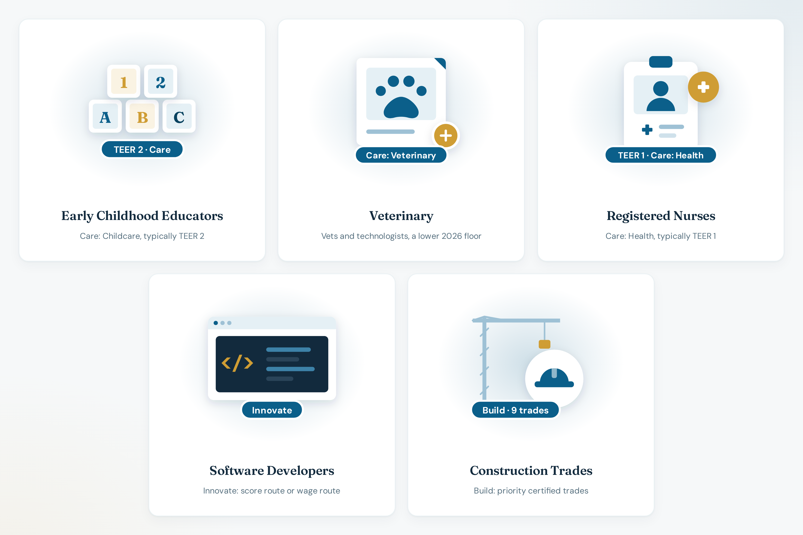

# Occupations

**Live:** [https://bcpnp.getnorthpath.com/occupations](https://bcpnp.getnorthpath.com/occupations)

Hub title: **Priority occupations and how BC classifies them.**

Worked examples under Care, Build, and Innovate: typical TEER, category placement, and 2026 score context. The page says to verify them against WelcomeBC.

### Occupations preview

| Occupations |
| :---: |
|  |

---

## Occupations on the hub

| Occupation | Page |
| --- | --- |
| Registered nurses | [occupations/registered-nurses](https://bcpnp.getnorthpath.com/occupations/registered-nurses) |
| Early childhood educators | [occupations/early-childhood-educators](https://bcpnp.getnorthpath.com/occupations/early-childhood-educators) |
| Veterinary | [occupations/veterinary](https://bcpnp.getnorthpath.com/occupations/veterinary) |
| Construction trades | [occupations/construction-trades](https://bcpnp.getnorthpath.com/occupations/construction-trades) |
| Software developers | [occupations/software-developers](https://bcpnp.getnorthpath.com/occupations/software-developers) |

TEER and category lines: [OCCUPATIONS.md](../OCCUPATIONS.md)

The hub links onward to the three pillars, the occupation finder, and the regions hub. The finder is the place that says the underlying list is a demo subset.

---

## Related pages

- [Occupation finder](https://bcpnp.getnorthpath.com/tools/noc-teer-finder)
- [Pillars](https://bcpnp.getnorthpath.com/pillars)
- [Regions](https://bcpnp.getnorthpath.com/regions)
