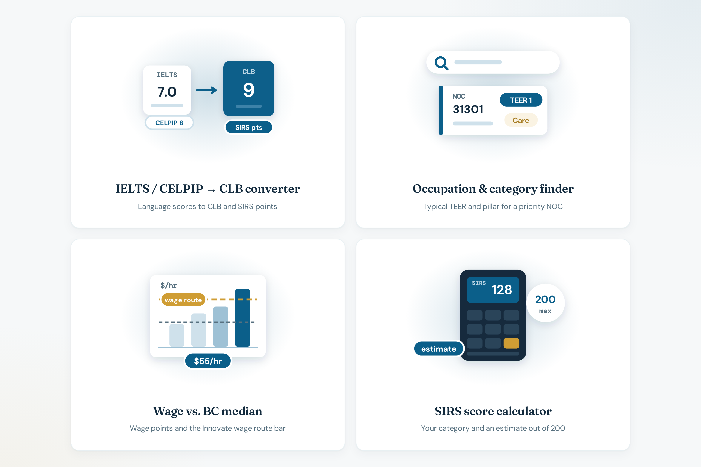

# Tools

**Live:** [https://bcpnp.getnorthpath.com/tools](https://bcpnp.getnorthpath.com/tools)

Hub title: **BC PNP tools that answer one question each.** Page title: *Free BC PNP Tools | CLB, NOC/TEER & Wage*.

### Tools preview

| Tools |
| :---: |
|  |

---

## What you do here

1. Open one of the three tools
2. Convert a language score, look up a demo occupation, or compare a wage with a median
3. Carry the result into the calculator
4. Continue to pillars, the “What is the BC PNP?” guide, or the FAQ

The hub states there are **3 tools**. Descriptions on the cards:

| # | Tool | Card line |
| --- | --- | --- |
| 01 | [IELTS / CELPIP → CLB converter](https://bcpnp.getnorthpath.com/tools/clb-converter) | Convert IELTS General or CELPIP General scores to CLB levels and estimated SIRS language points, per ability |
| 02 | [Priority occupation & category finder (demo subset)](https://bcpnp.getnorthpath.com/tools/noc-teer-finder) | Look up a priority occupation’s typical TEER and which pillar it usually falls under |
| 03 | [Wage vs. BC median](https://bcpnp.getnorthpath.com/tools/wage-vs-median) | Compare an offered hourly wage to a BC median and see estimated SIRS wage points, including the Innovate wage-route bar |

Behavior: [TOOLS.md](../TOOLS.md)

---

## Related pages

- [Pillars](https://bcpnp.getnorthpath.com/pillars)
- [What is the BC PNP?](https://bcpnp.getnorthpath.com/guide/what-is-bc-pnp)
- [FAQ](https://bcpnp.getnorthpath.com/faq)
